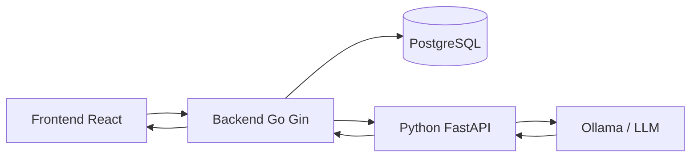

<div align="center">


# Story2Gherkin

**Mengubah user story menjadi draft skenario pengujian Gherkin dengan bantuan LLM.**


[Tentang](#tentang-proyek) · [Instalasi](#instalasi-dan-konfigurasi) · [Menjalankan](#menjalankan-aplikasi) · [API](#api) · [Testing](#pengujian)

</div>

---

## Daftar Isi

- [Tentang Proyek](#tentang-proyek)
- [Fitur dan Status](#fitur-dan-status)
- [Arsitektur](#arsitektur)
- [Teknologi](#teknologi)
- [Struktur Repository](#struktur-repository)
- [Prasyarat](#prasyarat)
- [Instalasi dan Konfigurasi](#instalasi-dan-konfigurasi)
- [Menjalankan Aplikasi](#menjalankan-aplikasi)
- [API](#api)
- [Pengujian](#pengujian)
- [Perintah Penting](#perintah-penting)
- [Kontribusi Tim](#kontribusi-tim)
- [Kendala Umum](#kendala-umum)
- [Referensi](#referensi)

## Tentang Proyek

Story2Gherkin adalah proyek untuk membantu System Analyst dan QA menyusun skenario pengujian
berformat **Gherkin**. Pengguna memberikan kebutuhan fitur, elemen GUI, dan gambaran alur,
kemudian sistem membantu menghasilkan draft skenario `Given–When–Then` untuk ditinjau.

Repository ini menyatukan tiga bagian aplikasi:

- **Frontend:** antarmuka pengguna berbasis React.
- **Backend:** REST API Go untuk autentikasi, proses bisnis, dan penyimpanan data.
- **AI service:** layanan Python untuk berkomunikasi dengan LLM dan memvalidasi hasil generasi.

Hasil AI merupakan draft. Sintaks Gherkin yang valid tetap perlu ditinjau untuk memastikan
kesesuaiannya dengan aturan bisnis.

## Fitur dan Status

| Bagian | Implementasi saat ini |
| --- | --- |
| Autentikasi | Endpoint register, login, logout, refresh token, dan reset password |
| Generate scenario — Go | Endpoint dengan Bearer JWT, validasi input, retry terbatas, dan perhitungan cakupan GUI |
| Penyimpanan | Model/migrasi pengguna, refresh token, generation request, dan hasil Gherkin |
| AI service — Python | Pemanggilan Ollama, JSON terstruktur, validasi Pydantic, dan parser Gherkin |
| Frontend | Kerangka React/Vite; halaman dan integrasi aplikasi masih dikembangkan |
| Pengujian Go | Unit test handler/service dan BDD menggunakan Godog |
| Pengujian Python | Suite unit/API/BDD sudah disiapkan; perlu ditambahkan ke repo sebelum menjalankan perintah test Python |

> **Status integrasi:** kontrak generate Go dan Python masih berbeda. Go menerima
> `gui_elements` dan `free_scenario`, sedangkan Python saat ini menerima `acceptance_criteria`,
> `max_scenarios`, dan `language`. Referensi output juga berbeda:
> `gui_element_ids` pada Go dan `criterion_ids` pada Python.
> Kontrak input dan output perlu diselaraskan sebelum alur generate lintas layanan dapat dinyatakan selesai.

## Arsitektur

Diagram berikut menunjukkan pembagian tanggung jawab dan alur integrasi yang dituju.
Status implementasinya mengikuti tabel di atas.



Backend menangani identitas pengguna dan penyimpanan. AI service menangani prompt,
pemanggilan model, serta pemeriksaan hasil. Service key internal digunakan untuk komunikasi
Go–Python; key ini berbeda dari JWT pengguna.

## Teknologi

| Kebutuhan | Teknologi |
| --- | --- |
| Frontend | React, TypeScript, Vite |
| Backend | Go, Gin, GORM |
| Dependency injection | samber/do |
| Database | PostgreSQL |
| Autentikasi | JWT, refresh token, bcrypt |
| AI service | Python, FastAPI, Pydantic, HTTPX |
| Model runtime | Ollama; model dikonfigurasi melalui environment |
| Validasi skenario | Gherkin official parser |
| Pengujian | Go testing, httptest, Godog, pytest, pytest-bdd, pytest-cov |
| Kolaborasi | Git, GitHub Issues, Pull Requests |

## Struktur Repository

```text
Story2Gherkin/
├── README.md
├── docs/assets/
│   └── story2gherkin-logo.svg
├── .github/ISSUE_TEMPLATE/
├── frontend/
│   ├── public/
│   ├── src/
│   └── package.json
├── backend/
│   ├── cmd/main.go             # Entry point API
│   ├── config/                 # Database, logger, email
│   ├── database/               # Entity dan migrasi GORM
│   ├── middlewares/            # Autentikasi dan CORS
│   ├── modules/
│   │   ├── auth/
│   │   ├── user/
│   │   └── scenario/
│   ├── pkg/                    # Helper, konstanta, respons API
│   ├── providers/              # Penyusunan dependency
│   ├── test/
│   │   ├── auth/
│   │   ├── scenario/
│   │   └── bdd/features/
│   ├── .env.example
│   └── go.mod
└── ai-service/
    ├── app/
    │   ├── main.py             # FastAPI dan endpoint internal
    │   ├── config.py
    │   ├── schemas.py
    │   ├── prompts.py
    │   ├── llm_client.py
    │   ├── generator.py
    │   └── requirements.txt
    └── .env.example
```

Setelah suite pengujian Python ditambahkan, folder `ai-service/tests` berisi `unit`,
`api`, dan `bdd` beserta konfigurasi `pytest.ini` dan `requirements-dev.txt`.

## Prasyarat

| Perangkat lunak | Keterangan |
| --- | --- |
| Git | Mengambil kode dan mengelola branch |
| Go | Sesuai `backend/go.mod`, saat ini `1.26.5` |
| Python | `3.11+` untuk AI service |
| Node.js dan npm | Gunakan Node.js `22.12+` atau `24+` yang kompatibel dengan dependency frontend |
| PostgreSQL | Database lokal yang sudah berjalan |
| Ollama | Diperlukan untuk inferensi model lokal |
| pgAdmin / Apidog | Opsional, untuk pengelolaan database dan pengujian API manual |

Model dapat dijalankan melalui CPU jika kapasitas perangkat mencukupi; waktu inferensi perlu diukur.
Unit test yang memakai mock tidak memerlukan GPU atau model yang sedang berjalan.

## Instalasi dan Konfigurasi

Contoh berikut menggunakan **Windows PowerShell**.

### 1. Ambil repository

```powershell
git clone https://github.com/AgilePemdigi-2026/Story2Gherkin.git
cd Story2Gherkin
```

Gunakan branch tim yang memuat fitur yang ingin dijalankan. Struktur dan kontrak dalam README
ini mengikuti implementasi yang diperiksa; periksa perubahan jika berpindah branch.

### 2. Siapkan PostgreSQL

Pastikan layanan PostgreSQL aktif. pgAdmin digunakan sebagai alat pengelola, bukan pengganti
proses server database.

Pada Query Tool yang terhubung ke database `postgres`, buat database jika belum ada:

```sql
CREATE DATABASE story2gherkin;
```

Kemudian buka Query Tool pada database **story2gherkin**, lalu jalankan:

```sql
CREATE EXTENSION IF NOT EXISTS "uuid-ossp";
```

Gunakan akun PostgreSQL yang memiliki izin membuat tabel pada database tersebut.
Migrasi tabel dijalankan otomatis ketika backend mulai.

### 3. Siapkan environment backend

```powershell
Copy-Item backend/.env.example backend/.env
```

Sesuaikan `backend/.env`:

```dotenv
APP_NAME=Story2Gherkin
APP_ENV=localhost
IS_LOGGER=true
GOLANG_PORT=8888

DB_HOST=127.0.0.1
DB_USER=postgres
DB_PASS=GANTI_DENGAN_PASSWORD_DATABASE
DB_NAME=story2gherkin
DB_PORT=5432

JWT_SECRET=GANTI_DENGAN_SECRET_JWT_ACAK
AI_SERVICE_URL=http://127.0.0.1:8001
AI_SERVICE_KEY=GANTI_DENGAN_SECRET_INTERNAL_ACAK

SMTP_HOST=smtp.gmail.com
SMTP_PORT=587
SMTP_SENDER_NAME="Story2Gherkin"
SMTP_AUTH_EMAIL=email-pengirim@gmail.com
SMTP_AUTH_PASSWORD=GANTI_DENGAN_APP_PASSWORD
```

`DB_HOST=postgres` pada contoh bawaan mengasumsikan hostname tersebut tersedia.
Untuk instalasi PostgreSQL lokal di atas, gunakan `127.0.0.1`.
SMTP diperlukan saat mengirim email reset password. Sesuaikan pengirim dan kredensial
dengan layanan email yang digunakan; untuk Gmail gunakan App Password.

### 4. Buat secret dan konfigurasi AI service

Untuk membuat secret acak:

```powershell
$secretBytes = New-Object byte[] 32
$rng = [System.Security.Cryptography.RandomNumberGenerator]::Create()
$rng.GetBytes($secretBytes)
[Convert]::ToBase64String($secretBytes)
$rng.Dispose()
```

Jalankan dua kali untuk memperoleh nilai `JWT_SECRET` dan `AI_SERVICE_KEY` yang berbeda.
Gunakan nilai `AI_SERVICE_KEY` yang sama pada backend dan AI service.

```powershell
Copy-Item ai-service/.env.example ai-service/.env
```

Isi `ai-service/.env`:

```dotenv
OLLAMA_URL=http://127.0.0.1:11434
OLLAMA_MODEL=qwen3.5:4b
OLLAMA_TIMEOUT_SECONDS=120
AI_SERVICE_KEY=SECRET_INTERNAL_YANG_SAMA_DENGAN_BACKEND
```

Simpan nilai asli hanya di environment lokal. Commit `.env.example` dengan placeholder,
bukan `.env` yang berisi kredensial. Jika secret sudah ter-push, ganti nilainya.

### 5. Pasang dependency

Backend:

```powershell
cd backend
go mod download
cd ..
```

AI service:

```powershell
cd ai-service
python -m venv .venv
.\.venv\Scripts\python.exe -m pip install -r app/requirements.txt
cd ..
```

Frontend:

```powershell
cd frontend
npm ci
cd ..
```

### 6. Siapkan model

Pasang [Ollama untuk Windows](https://docs.ollama.com/windows), kemudian buka kembali terminal:

```powershell
ollama --version
ollama pull qwen3.5:4b
```

`qwen3.5:4b` adalah model awal pada konfigurasi, bukan hasil evaluasi final proyek.
Nama model bisa diganti melalui `OLLAMA_MODEL`. Perintah `pull` mengunduh model siap pakai;
tidak diperlukan training atau fine-tuning untuk menjalankan alur awal ini.
[Detail model di Ollama](https://ollama.com/library/qwen3.5:4b).

## Menjalankan Aplikasi

Pastikan PostgreSQL dan Ollama berjalan, lalu gunakan terminal terpisah untuk setiap service.
Setiap perintah di bawah dimulai dari **root repository**.

### Terminal 1 — AI service

```powershell
cd ai-service
.\.venv\Scripts\python.exe -m uvicorn app.main:app --host 127.0.0.1 --port 8001
```

Jalankan melalui Uvicorn agar relative import Python bekerja. Jika memakai environment
lain yang sudah aktif, gunakan `python -m uvicorn` dari environment tersebut.

### Terminal 2 — Backend

```powershell
cd backend
go run ./cmd
```

Jalankan dari folder `backend` karena aplikasi membaca `.env` pada direktori kerja.
Entry point saat ini adalah `cmd/main.go`.

### Terminal 3 — Frontend

```powershell
cd frontend
npm run dev
```

| Layanan | Alamat lokal |
| --- | --- |
| Frontend | `http://localhost:5173`, atau alamat yang ditampilkan Vite |
| Backend API | `http://localhost:8888/api/v1` |
| AI service health | `http://127.0.0.1:8001/health` |
| AI service API docs | `http://127.0.0.1:8001/docs` |
| Ollama | `http://127.0.0.1:11434` |

Ollama Windows biasanya berjalan di background setelah instalasi. Jika belum aktif,
jalankan `ollama serve` pada terminal tambahan.
Respons `{"status":"ok"}` dari health Python hanya menunjukkan proses hidup, bukan kesiapan model.
Frontend saat ini masih menampilkan template sampai halaman aplikasi diimplementasikan.

## API

Gunakan `Content-Type: application/json` untuk request JSON.

### API publik — Backend Go

| Metode | Endpoint | Fungsi |
| --- | --- | --- |
| POST | `/api/v1/auth/register` | Membuat akun |
| POST | `/api/v1/auth/login` | Mendapatkan access token dan refresh token |
| POST | `/api/v1/auth/logout` | Mengembalikan respons logout |
| POST | `/api/v1/auth/refresh` | Memperbarui token |
| POST | `/api/v1/auth/password-reset/send` | Mengirim email reset password |
| POST | `/api/v1/auth/password-reset/reset` | Mengganti password memakai token reset |
| POST | `/api/v1/scenarios/generate` | Meminta generate; membutuhkan Bearer token |

<details>
<summary><strong>Contoh request register dan login</strong></summary>

Register:

```json
{
  "name": "Pengguna Uji",
  "email": "pengguna@example.com",
  "password": "PasswordUji123!",
  "role": "qa"
}
```

Role pada model pengguna: `qa` dan `system_analyst`.

Login:

```json
{
  "email": "pengguna@example.com",
  "password": "PasswordUji123!"
}
```

Gunakan `data.access_token` pada header `Authorization: Bearer TOKEN` untuk endpoint terlindungi.
Jangan mengirim refresh token sebagai access token.

</details>

<details>
<summary><strong>Kontrak generate pada backend Go</strong></summary>

```json
{
  "user_story": "As a registered user, I want to log in to access my dashboard.",
  "gui_elements": ["Login button", "Password field"],
  "free_scenario": "The user enters a password in the Password field and clicks the Login button. Valid credentials open the dashboard; an incorrect password shows an error."
}
```

Backend memvalidasi input, mencatat generation request, dan memanggil AI service.
Hasil yang diterima divalidasi, cakupan GUI dihitung, lalu hasil disimpan.
Input ini masih perlu dipetakan ke kontrak Python sebelum alur lintas service berhasil.

</details>

### API internal — Python

| Metode | Endpoint | Keterangan |
| --- | --- | --- |
| GET | `/health` | Liveness |
| POST | `/internal/scenarios/generate` | Generate melalui LLM; membutuhkan `X-AI-Service-Key` |

Frontend menggunakan API Go. Service key internal tidak diberikan kepada browser.

<details>
<summary><strong>Kontrak generate pada Python saat ini</strong></summary>

```json
{
  "user_story": "As a registered user, I want to log in.",
  "acceptance_criteria": [
    "Valid credentials allow login.",
    "An incorrect password is rejected."
  ],
  "max_scenarios": 4,
  "language": "en"
}
```

Respons Python memuat `feature`, `gherkin`, `model`, `prompt_version`, dan `duration_ms`.
Model diminta menghasilkan JSON terstruktur, kemudian Pydantic dan parser Gherkin memeriksanya.
Warning disertakan jika ada acceptance criteria yang tidak direferensikan hasil.

</details>

**Perilaku logout saat ini:** endpoint mengembalikan sukses tanpa mencabut token.
Frontend bertanggung jawab menghapus access token, refresh token, dan state autentikasi.
Jangan menganggap respons logout sebagai bukti token lama sudah tidak bisa digunakan.

## Pengujian

### Go — Unit test dan BDD

Dari folder `backend`:

```powershell
go test ./...
go test ./test/auth/... -count=1 -v
go test ./test/scenario/... -count=1 -v
go test ./test/bdd -count=1 -v
```

BDD Go menggunakan Godog dan file `.feature` di `backend/test/bdd/features`.
Test dengan stub memeriksa aturan/response aplikasi, bukan membuktikan koneksi database
atau kualitas model LLM yang sebenarnya.

### Python — Setelah suite pengujian ditambahkan

Pastikan `tests/`, `pytest.ini`, `.coveragerc`, dan `requirements-dev.txt` tersedia di `ai-service`.
File-file ini belum ditemukan pada snapshot repo yang menjadi dasar README ini.

```powershell
cd ai-service
.\.venv\Scripts\python.exe -m pip install -r requirements-dev.txt
.\.venv\Scripts\python.exe -m pytest tests/unit -v
.\.venv\Scripts\python.exe -m pytest tests/api -v
.\.venv\Scripts\python.exe -m pytest tests/bdd -v
```

Untuk seluruh test dan laporan coverage:

```powershell
.\.venv\Scripts\python.exe -m pytest tests --cov=app --cov-branch --cov-report=term-missing --cov-report=html
```

BDD Python menggunakan pytest-bdd. Test memakai HTTP mock agar tidak memerlukan GPU atau provider berbayar.
Hasil PASS dan coverage tinggi tidak menggantikan pengujian kontrak antarservice serta review kualitas hasil model.

### Frontend

Dari folder `frontend`:

```powershell
npm run lint
npm run build
```

Lint dan build bukan unit test UI. Script test frontend belum tersedia pada `package.json` saat ini.

## Perintah Penting

| Direktori kerja | Perintah | Kegunaan |
| --- | --- | --- |
| `backend` | `go run ./cmd` | Menjalankan API |
| `backend` | `go test ./...` | Menjalankan test Go |
| `backend` | `go test ./test/bdd -v` | Menjalankan BDD Go |
| `ai-service` | `python -m uvicorn app.main:app --port 8001` | Menjalankan Python dari environment aktif |
| `ai-service` | `python -m pytest -q` | Menjalankan suite Python jika sudah dipasang |
| `frontend` | `npm run dev` | Menjalankan Vite |
| `frontend` | `npm run build` | Build frontend |
| Terminal dengan Ollama | `ollama list` | Melihat model yang sudah diunduh |

## Kontribusi Tim

1. Ambil pekerjaan dari GitHub Issues dan sepakati acceptance criteria.
2. Pastikan pekerjaan lokal sudah tersimpan, lalu perbarui `develop`.
3. Buat branch fitur dari `develop` terbaru.
4. Kerjakan perubahan dan jalankan test yang relevan.
5. Buat Pull Request ke `develop` dan minta review anggota tim.
6. Gabungkan `develop` ke `main` setelah target sprint dan validasi tim terpenuhi.

```powershell
git switch develop
git pull --ff-only origin develop
git switch -c feat/nama-fitur
```

Gunakan template Feature melalui **Issues → New issue**. Konfigurasinya berada di
`.github/ISSUE_TEMPLATE/`. Cantumkan issue terkait pada Pull Request.
Periksa perubahan sebelum commit; `.env`, virtual environment, token, dan log tidak ikut dipush.

## Kendala Umum

| Pesan atau kondisi | Pemeriksaan |
| --- | --- |
| `open .env: ... file specified` | Pastikan `backend/.env` ada dan jalankan Go dari folder backend. |
| `password authentication failed` | Cocokkan username/password PostgreSQL dengan environment. |
| `database does not exist` | Buat database pada server PostgreSQL yang digunakan aplikasi. |
| `uuid_generate_v4() does not exist` | Aktifkan `uuid-ossp` pada database aplikasi. |
| `cannot find main module` | Jalankan perintah Go dari folder yang berisi `go.mod`. |
| `ollama is not recognized` | Install Ollama dan buka ulang terminal/VS Code. |
| `attempted relative import` | Jalankan `python -m uvicorn app.main:app` dari folder ai-service. |
| `.venv\Scripts\python.exe` tidak ditemukan | Buat virtual environment atau gunakan Python dari environment yang sudah aktif. |
| HTTP 401 saat generate | Periksa access token login dan header Bearer. |
| HTTP 502 saat generate | Periksa kontrak input/output Go–Python, service key, dan validitas output model. |
| HTTP 503 saat generate | Periksa proses Python/Ollama, model yang tersedia, dan slot generator. |
| HTTP 504 saat generate | Periksa durasi inferensi serta timeout; cocokkan kapasitas perangkat dengan model. |
| `no Go files` pada folder test | Pastikan file tersimpan sebagai `*_test.go`, bukan `.test` atau `.txt`. |

## Referensi

- [Gin](https://gin-gonic.com/docs/)
- [FastAPI](https://fastapi.tiangolo.com/)
- [Ollama untuk Windows](https://docs.ollama.com/windows)
- [Qwen3.5 pada Ollama](https://ollama.com/library/qwen3.5:4b)
- [Gherkin](https://cucumber.io/docs/gherkin/)
- [pytest-bdd](https://pytest-bdd.readthedocs.io/en/stable/)

